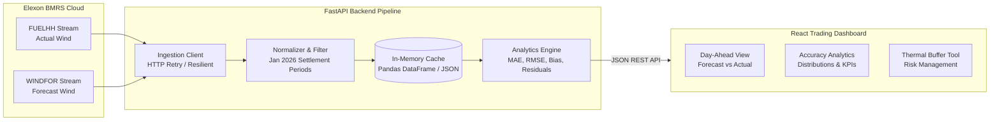

# UK Wind Power Day-Ahead Decision & Forecast Evaluation Platform
## System Blueprint, Architecture & Technical Requirements

---

## 1. Executive Summary & Domain Context

### 1.1 Business Objective
The client is a **UK Energy Utility** purchasing electricity in the wholesale day-ahead market to serve retail consumers. 
Because renewable sources (primarily wind) are weather-dependent and fluctuate continuously, the utility must decide **one day prior to delivery (Day $D-1$)** how much non-renewable dispatchable power (e.g., CCGT thermal plants, peakers, battery storage) needs to be procured to balance consumer demand.

To make informed commercial and operational decisions, the trading and procurement team requires:
1. **Latest Day-Ahead Renewable Forecasts**: Precise wind generation forecast available at the Day-Ahead decision cutoff for any target delivery day in **January 2026**.
2. **Quantitative Forecast Accuracy & Risk Evaluation**: Rigorous statistical metrics (MAE, RMSE, MAPE, Mean Bias Error, confidence intervals) and error distributions to size risk buffers and avoid expensive imbalance penalties under the UK Balancing Mechanism.

### 1.2 Data Sources & Reality Check (Elexon BMRS)
All data is sourced directly from Elexon BMRS public REST/Stream APIs:
- **Actual Wind Generation (`FUELHH` dataset)**:
  - Half-hourly national generation by fuel type.
  - Endpoint: `https://data.elexon.co.uk/bmrs/api/v1/datasets/FUELHH/stream`
  - Filter: `fuelType == "WIND"`, half-hour resolution (`startTime`, `generation` in MW).
- **Forecast Wind Generation (`WINDFOR` dataset)**:
  - Rolling forecasts published continuously with lookaheads from hours to several days.
  - Endpoint: `https://data.elexon.co.uk/bmrs/api/v1/datasets/WINDFOR/stream`
  - Fields: `publishTime` (when forecast was released), `startTime` (delivery settlement period), `generation` (projected MW).

### 1.3 Key UK Market Domain Rule: Day-Ahead Gate Closure
- In the UK wholesale day-ahead auctions (such as EPEX SPOT or Nord Pool UK), bids close around **11:00 or 12:00 GMT on Day $D-1$** for power delivery across all 48 half-hour settlement periods of Day $D$.
- **Critical Requirement**: For delivery on Day $D$, the application must isolate the **latest forecast published on or before Day $D-1$ at cutoff (e.g., 11:00 / 12:00 GMT)**. Comparing actuals against forecasts published *after* gate closure would introduce look-ahead bias and mislead traders.

---

## 2. Technical Stack Specification

| Tier | Technology | Purpose & Rationale |
| :--- | :--- | :--- |
| **Frontend Framework** | **React 18 + TypeScript + Vite** | Fast build times, strong type safety, low runtime overhead, zero boilerplate compared to heavyweight SSR setups. |
| **Frontend Styling** | **Tailwind CSS + Custom Utility Tokens** | High-density utility styling tailored for financial/energy trading dashboards. Dark/Light mode support, clear visual hierarchy. |
| **Data Visualization** | **Recharts + Lucide React** | Interactive time-series charts, dual-axis actual vs forecast, residual shortfall bars, error density distributions, and trading UI icons. |
| **Backend Framework** | **Python 3.10+ with FastAPI** | High performance asynchronous REST API with automatic OpenAPI documentation and native Pydantic data validation. |
| **Data Engine & Analysis**| **Pandas / NumPy** | Vectorized time-series alignment, Day-Ahead cutoff filtering, and statistical metrics (MAE, RMSE, MAPE, MBE). |
| **Data Storage / Caching** | **In-Memory (Pandas DataFrame) / Local JSON/Parquet** | Zero-dependency caching. January 2026 data is ~2 MB; holding it in memory provides instant sub-10ms queries with zero database overhead. |
| **Containerization** | **Docker & Docker Compose** | Multi-stage Dockerfiles for backend and frontend with unified single-command local run (`docker-compose up`). |
| **Deployment** | **Vercel (Frontend) + Render / Railway (Backend)** | Fast global CDN for React SPA and managed Python container service for backend API with zero cold-start headaches. |

---

## 3. Clean, Modular Project Structure

The project follows a clean separation of concerns: single-responsibility modules, decoupled backend data layers, typed API contracts, and reusable UI components.

```text
gridassign/
├── docker-compose.yml              # Single-command local orchestration
├── README.md                       # Complete setup, architecture, and video links
├── PROBLEMSTATEMENT.MD             # Original assignment prompt
├── PROJECT_BLUEPRINT.md            # This master blueprint document
│
├── backend/                        # Python FastAPI Backend
│   ├── Dockerfile                  # Production container for backend
│   ├── requirements.txt            # Pinned dependencies (FastAPI, uvicorn, pandas, etc.)
│   ├── main.py                     # App entry point & CORS configuration
│   ├── config.py                   # App settings (dates, gate cutoff hour, filepaths)
│   │
│   ├── api/                        # API route handlers (Controllers)
│   │   ├── __init__.py
│   │   ├── routes_forecast.py      # Endpoints for Day-Ahead forecasts & actuals
│   │   ├── routes_analytics.py     # Endpoints for statistical errors & metrics
│   │   └── routes_health.py        # Healthcheck and dataset status
│   │
│   ├── services/                   # Core business logic & analytics engine
│   │   ├── __init__.py
│   │   ├── elexon_client.py        # Resilient client for Elexon FUELHH and WINDFOR
│   │   ├── data_pipeline.py        # Ingestion, cleaning, caching, and matching logic
│   │   └── error_metrics.py        # Quant calculations: MAE, RMSE, MAPE, MBE, quantiles
│   │
│   ├── models/                     # Data schemas & validation
│   │   ├── __init__.py
│   │   ├── schemas.py              # Pydantic models for API responses
│   │   └── domain.py               # Domain dataclasses & constants
│   │
│   └── data/                       # Cached raw January 2026 Elexon data
│       └── raw/                    # Cached JSON files for instant startup (zero DB setup)
│
└── frontend/                       # React + TypeScript + Vite Frontend
    ├── Dockerfile                  # Nginx production container for frontend
    ├── package.json                # Frontend dependencies
    ├── vite.config.ts              # Vite configuration & dev proxy
    ├── tsconfig.json               # TypeScript strict configuration
    ├── tailwind.config.js          # Tailwind styling tokens
    │
    ├── src/
    │   ├── main.tsx                # React root mount
    │   ├── App.tsx                 # Core application shell & navigation
    │   │
    │   ├── api/                    # API client layer
    │   │   ├── client.ts           # Axios / Fetch client with error handling
    │   │   └── types.ts            # Generated TypeScript types matching backend schemas
    │   │
    │   ├── components/             # Modular UI components
    │   │   ├── common/             # Reusable primitives (Card, Badge, Button, Loader)
    │   │   ├── layout/             # Header, Navigation, Timezone/Date selector
    │   │   ├── forecast/           # Day-Ahead forecast vs actual chart, thermal gap card
    │   │   ├── analytics/          # Error histogram, MAE/RMSE KPI cards, bias gauge
    │   │   └── decision/           # Day-ahead procurement calculator & safety margin slider
    │   │
    │   ├── hooks/                  # Custom React hooks
    │   │   ├── useForecastData.ts  # Fetches day-ahead time-series for selected date
    │   │   └── useAnalytics.ts     # Fetches quantitative error statistics
    │   │
    │   └── utils/                  # Formatting & math utilities
    │       ├── dateUtils.ts        # Settlement period and date conversions (HH 1-48)
    │       └── formatters.ts       # Megawatt (MW) and percentage formatters
```

---

## 4. Core Features & Functional Specification

### 4.1 Feature 1: Day-Ahead Purchase Decision Workspace
- **Delivery Date Picker**: Select any delivery day across **January 2026** (Jan 1 to Jan 31).
- **Decision Cutoff Simulator**: Allows adjusting the Day-Ahead auction cutoff (default: **11:00 GMT on Day $D-1$**).
- **Interactive Time-Series Visualizer**:
  - 48 settlement periods (00:00 to 24:00).
  - Synchronized curves:
    - **Wind Forecast Available at Cutoff (MW)**
    - **Actual Wind Delivered (MW)**
    - **Delta / Variance (Overforecast / Underforecast)**
  - Synthetic or customizable **System Demand Baseline**: Visualizes the **Net Residual Thermal Procurement** required (Demand minus Wind).
- **Key Summary Metrics for Selected Day**:
  - Total Forecast Wind Energy (MWh)
  - Total Actual Wind Energy (MWh)
  - Peak Day Deficit / Surplus (MW)
  - Imbalance Exposure Risk Index

### 4.2 Feature 2: Quantitative Forecast Error & Accuracy Engine
- **Statistical Accuracy Dashboard**:
  - **Mean Absolute Error (MAE)** in MW and % of capacity.
  - **Root Mean Square Error (RMSE)**: Penalizes severe outlier errors.
  - **Mean Absolute Percentage Error (MAPE)**.
  - **Mean Bias Error (MBE)**: Demonstrates whether the forecasting model systematically over-predicts or under-predicts wind generation.
- **Error Distribution & Density**:
  - Histogram of forecast errors ($Actual - Forecast$) showing normality, skew, and heavy tails.
- **Settlement Period Breakdown**:
  - Heatmap or 48-period bar chart identifying which hours of the day suffer from the greatest forecast divergence (e.g., morning ramp vs evening peak).
- **Forecast Revision Evolution (Lookahead Drift)**:
  - Track how forecasts evolved from $T-48\text{h}$, $T-24\text{h}$, to $T-4\text{h}$ before delivery.

### 4.3 Feature 3: Decision Support & Thermal Procurement Buffer
- **Confidence Interval Band**: Overlay $\text{P10}$ / $\text{P50}$ / $\text{P90}$ forecast bounds onto the day-ahead schedule.
- **Procurement Safety Margin Recommendation**:
  - Suggests additional thermal capacity to hold in reserve based on historical 95th percentile error.
  - Helps the utility minimize costly imbalance cash-out prices.

---

## 5. Data Flow & Ingestion Architecture



1. **Ingestion**: The backend pre-loads and caches January 2026 actuals (`FUELHH`) and forecasts (`WINDFOR`).
2. **Matching Algorithm**:
   - For any delivery period $T$ on Day $D$, find all forecasts in `WINDFOR` where `startTime == T`.
   - Filter down to forecasts where `publishTime <= cutoff_time(Day D-1)`.
   - Take the most recent forecast (maximum `publishTime`) before the cutoff.
   - Join with the actual generation from `FUELHH` for period $T$.
3. **Caching**: Results are held directly in-memory as Pandas DataFrames so that user clicks in the UI respond in `< 10ms` with zero database overhead.

---

## 6. Implementation & Verification Roadmap

| Stage | Milestones | Estimated Effort |
| :--- | :--- | :--- |
| **Phase 1: Backend & Data Core** | Data ingestion script for Jan 2026, in-memory caching, time-alignment logic, statistical error engine, and FastAPI endpoints. | 3.0 hrs |
| **Phase 2: Modern Frontend Dashboard** | Vite + React + Tailwind setup, Recharts time-series, date picker, KPI cards, and error distribution charts. | 4.5 hrs |
| **Phase 3: Decision Support & Polish** | Thermal procurement calculation, safety margin slider, dark/light theme, micro-interactions, responsive layout. | 3.0 hrs |
| **Phase 4: Dockerization & Testing** | Multi-stage Dockerfiles, docker-compose orchestration, end-to-end integration validation. | 2.0 hrs |
| **Phase 5: Deployment & Deliverables** | Deploy frontend (Vercel) + backend (Render/Railway), README documentation, demo video script & recording prep. | 2.5 hrs |
| **Total** | **Comprehensive, production-grade prototype** | **~15.5 hrs** (Within 16 hr budget) |

---

## 7. Deliverables & Evaluation Checklist

- [ ] **Dockerized Application**:
  - `docker-compose up` runs both backend and frontend out of the box.
- [ ] **Live Hosted Demo**:
  - Frontend on Vercel with fast global CDN.
  - Backend API accessible over public HTTPS.
- [ ] **Clean Anonymous GitHub Repository**:
  - Name: random slug (e.g., `kjhwr` or similar as requested).
  - Clear README with architecture overview, directory map, run instructions, and live links.
- [ ] **10-Minute Video Demo (YouTube Unlisted)**:
  - **Part 1 (Client Pitch, $\le 5$ min)**: Business value, Day-Ahead decision workflow, how forecast error quantification protects profit margins.
  - **Part 2 (Tech Lead Review, $\le 5$ min)**: Clean code modularity, Elexon data pipeline, Day-Ahead cutoff matching algorithm, Docker setup, and testing.
- [ ] **Submission Form**:
  - Verified in incognito mode before final submission: [Submission Form Link](https://forms.cloud.microsoft/r/FTX6K2bbnU).

---

## 8. Requirements Needed from Your Side (User Checklist)

To ensure smooth execution without roadblocks, here are the few items needed/recommended from your side:

1. **Deployment Preference**:
   - We plan to deploy the **Frontend to Vercel** (instant, free, high performance) and the **Backend to Render or Railway** (free tier container hosting). If you have existing accounts or a specific hosting preference (e.g., Heroku, Fly.io, AWS), please let us know.
2. **GitHub Account**:
   - When ready for submission, we will create/push to a public repository with an anonymous name (e.g. `grid-kjhwr`). Confirm if you want to push from your local git CLI or want us to prepare the repo bundle.
3. **Day-Ahead Auction Cutoff Confirmation**:
   - We have set the default Day-Ahead decision cutoff to **11:00 GMT on Day $D-1$** (standard UK EPEX SPOT auction gate). We also provide an interactive slider so the user can test alternate cutoff hours (e.g., 09:00 or 14:00 GMT).
4. **YouTube Recording Tool**:
   - For the required 10-minute demo video (Part 1: Client Pitch, Part 2: Tech Lead review), we will provide a comprehensive slide-by-slide script and live demo walkthrough checklist so recording it with OBS / Loom takes minimal time and delivers high impact.
